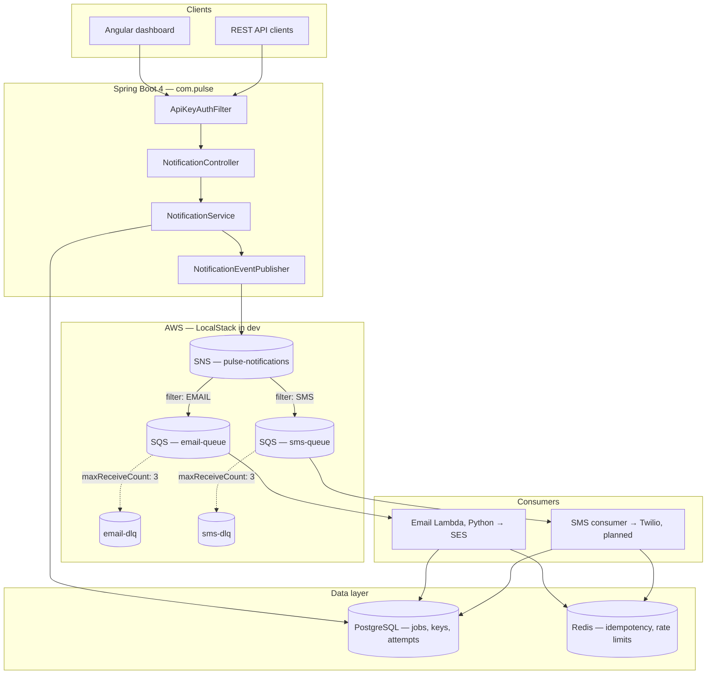

# Pulse

**Pulse** is an event-driven notification platform for delivering messages across email and SMS using an AWS SNS fan-out architecture with per-channel SQS consumers.

> *Pulse*: the signal that something happened, a heartbeat from your application to your users.

---

## Architecture

Pulse accepts notification jobs over a REST API, persists them to PostgreSQL, and publishes events to a central SNS topic that fans out to per-channel SQS queues. Each channel is processed independently with retry logic, dead-letter queues, and Redis-backed idempotency.



### Why SNS fan-out?

Publishing directly to a single queue and routing by channel inside one consumer couples every channel to a single worker. SNS fan-out decouples routing entirely: each channel is an independent subscriber with its own queue, retry policy, and dead-letter queue.

Adding a new channel (such as push) means creating a new SQS queue and SNS subscription with a message filter. No changes to the producer or existing consumers. Message filter policies on the `channel` attribute ensure each queue only receives relevant events.

### Package layout

```
com.pulse/
├── PulseApplication.java
├── api/
│   ├── controller/          # NotificationController
│   ├── dto/                 # NotificationRequest, NotificationResponse
│   └── exception/           # GlobalExceptionHandler, JobNotFoundException
├── auth/                    # ApiKeyAuthFilter (X-API-Key, SHA-256)
├── config/                  # SecurityConfig, AwsConfig (SNS/SQS clients)
├── domain/                  # NotificationJob, ApiKey, Channel, enums
├── notification/
│   ├── service/             # NotificationService
│   └── publisher/           # NotificationEventPublisher
└── repository/              # JPA repositories
```

### Design decisions

| Concern | Approach |
|--------|----------|
| **Auth** | API keys passed via `X-API-Key` header; stored as SHA-256 hashes in PostgreSQL. |
| **Job lifecycle** | `PENDING` → `PROCESSING` → `DELIVERED` / `FAILED`. Jobs persisted before SNS publish. |
| **Fan-out** | One SNS message per channel with a `channel` message attribute for filter policies. |
| **Idempotency** | Optional `idempotencyKey` on create. The email Lambda claims each `(jobId, channel)` with Redis `SET NX` before sending, and releases the claim if the send fails so a retry can try again. |
| **Channel isolation** | Separate SQS queues and DLQs per channel; a Twilio outage does not block email. |
| **Local dev** | LocalStack emulates SNS, SQS, and SES; `aws-init` provisions queues and subscriptions on startup. |
| **Infrastructure** | Terraform in `infra/`: VPC, ECS Fargate behind an ALB, RDS, ElastiCache, SNS/SQS with DLQs, and the email Lambda. |
| **Releases** | GitHub Actions deploys to ECS only after the JUnit tests, Terraform validation, and Docker build pass. |

### Tech stack

- Java 21, Spring Boot 4.0.6
- PostgreSQL 16 (Docker) — jobs, API keys, delivery attempts
- Redis 7: idempotency claims in the email consumer
- AWS SNS + SQS + SES via AWS SDK v2
- Python 3.12 AWS Lambda (email consumer)
- LocalStack 3 for local AWS emulation
- Spring Data JPA + Flyway
- Spring Security (API key filter)
- Angular 20 dashboard (`frontend/`)
- Terraform, Docker, Amazon ECS Fargate (`infra/`)
- GitHub Actions CI/CD, JUnit 5 + Mockito

### Repository layout

```
.
├── src/                  # Spring Boot API (com.pulse)
├── lambda/email-consumer # Python Lambda: SQS → Redis claim → SES → Postgres
├── frontend/             # Angular dashboard
├── infra/                # Terraform for AWS
├── scripts/              # LocalStack setup, Lambda packaging, load test
└── .github/workflows/    # CI and deploy pipelines
```

---

## Prerequisites

- Java 21
- Docker Desktop (for Postgres, Redis, and LocalStack)

---

## Local setup

### 1. Start infrastructure

```bash
docker compose up -d
```

This starts:

| Service | Host port | Purpose |
|---------|-----------|---------|
| `pulse-postgres` | **5433** | PostgreSQL (avoids conflict with a local install on 5432) |
| `pulse-redis` | 6379 | Redis |
| `pulse-localstack` | 4566 | SNS, SQS, SES emulation |
| `pulse-aws-init` | — | One-shot: creates SNS topic, queues, DLQs, and subscriptions |

Wait for all containers to be healthy. The `aws-init` container provisions:

- SNS topic: `pulse-notifications`
- Queues: `email-queue`, `sms-queue` (with `email-dlq`, `sms-dlq`)
- Filtered SNS → SQS subscriptions (`channel = EMAIL` / `channel = SMS`)

### 2. Seed a dev API key

API keys are stored as SHA-256 hashes. Insert a local dev key:

```sql
INSERT INTO api_keys (name, key_hash)
VALUES (
  'dev-key',
  'ad2be3b1edd1a3e7837e53b8db58da0ca4e54e82c328e1cf863dff824268cc35'
);
```

Run via Docker:

```bash
docker exec -i pulse-postgres psql -U pulse -d pulse -c \
  "INSERT INTO api_keys (name, key_hash) VALUES ('dev-key', 'ad2be3b1edd1a3e7837e53b8db58da0ca4e54e82c328e1cf863dff824268cc35') ON CONFLICT DO NOTHING;"
```

Raw key value: `pulse-dev-key-local`

### 3. Run the application

```bash
./mvnw spring-boot:run
```

On Windows:

```powershell
.\mvnw.cmd spring-boot:run
```

Health check: `GET http://localhost:8080/actuator/health`

### 4. Run the email consumer

In AWS, SQS invokes the Lambda directly. Locally, a small poller plays that role:

```bash
pip install -r lambda/email-consumer/requirements.txt
python lambda/email-consumer/local_poller.py --workers 4
```

### 5. Open the dashboard

```bash
cd frontend
npm install
npm start
```

Visit http://localhost:4200 and enter `pulse-dev-key-local` as the API key.

---

## API overview

All endpoints except `/actuator/*` require:

```
X-API-Key: <your-api-key>
```

### Notifications

| Method | Path | Status | Description |
|--------|------|--------|-------------|
| POST | `/api/v1/notifications` | 202 | Create and enqueue a notification job |
| GET | `/api/v1/notifications` | 200 | List your jobs, newest first (`status`, `page`, `size` up to 100) |
| GET | `/api/v1/notifications/{id}` | 200 | Get job status by ID |

**Create notification**

```bash
curl -X POST http://localhost:8080/api/v1/notifications \
  -H "X-API-Key: pulse-dev-key-local" \
  -H "Content-Type: application/json" \
  -d '{
    "channels": ["EMAIL"],
    "subject": "Hello",
    "body": "Hello world",
    "recipientEmail": "test@example.com"
  }'
```

Response `202 Accepted`:

```json
{
  "jobId": "uuid",
  "status": "PROCESSING",
  "channels": ["EMAIL"],
  "createdAt": "2026-06-05T18:23:06.395Z"
}
```

**List jobs**

```bash
curl "http://localhost:8080/api/v1/notifications?status=DELIVERED&page=0&size=20" \
  -H "X-API-Key: pulse-dev-key-local"
```

Returns `{ "content": [...], "page": 0, "size": 20, "totalElements": 42, "totalPages": 3 }`.

**Get job status**

```bash
curl http://localhost:8080/api/v1/notifications/{jobId} \
  -H "X-API-Key: pulse-dev-key-local"
```

### Error responses

| Status | Cause |
|--------|-------|
| 401 | Missing or invalid `X-API-Key` |
| 400 | Validation failure (missing `channels`, blank `body`, etc.) |
| 404 | Job not found |

### Planned endpoints

| Method | Path | Description |
|--------|------|-------------|
| POST/GET/PUT | `/api/v1/templates` | Template CRUD with variable substitution |
| GET | `/api/v1/admin/dlq` | Inspect dead-letter queue messages |
| POST | `/api/v1/admin/dlq/{messageId}/reprocess` | Reprocess a failed message |
| GET | `/api/v1/admin/metrics/summary` | Delivery metrics summary |

---

## Notification flow

1. Client sends `POST /api/v1/notifications` with channel(s), body, and recipient fields.
2. `ApiKeyAuthFilter` validates the API key (SHA-256 lookup in PostgreSQL).
3. `NotificationService` persists a `notification_jobs` record and publishes one SNS message per channel.
4. SNS fans out to `email-queue` and `sms-queue` via channel filter policies.
5. The email Lambda claims the job in Redis, sends through SES, and records the attempt in PostgreSQL. Failed messages are retried by SQS and move to the DLQ after 3 attempts. (SMS delivery through Twilio is planned.)

---

## Load testing

`scripts/load-test/load_test.py` (standard library only) measures how many notifications per minute the API accepts and, with `--wait-for-delivery`, how many the email consumer delivers end to end.

With the API and `local_poller.py` running:

```bash
python scripts/load-test/load_test.py --duration 60 --concurrency 16 --wait-for-delivery
```

It prints accepted/min, latency percentiles (p50, p95, p99), and delivered/min. Results depend on your machine and on how many poller workers you run.

---

## CI/CD and deployment

| Workflow | Runs on | What it does |
|----------|---------|--------------|
| `ci.yml` | Pushes to branches and pull requests | JUnit tests against Postgres, `terraform fmt` and `validate`, Angular build, Docker build |
| `deploy.yml` | Pushes to `main` | Reruns CI, then (only if it passes) pushes the image to ECR, runs `terraform apply`, waits for the ECS rollout, and checks `/actuator/health` |

The deploy job is skipped until these repository secrets exist:

- `AWS_DEPLOY_ROLE_ARN`: IAM role GitHub Actions assumes through OIDC
- `TF_STATE_BUCKET`: S3 bucket for Terraform state

To deploy by hand:

```bash
./scripts/build-lambda.sh
cd infra
terraform init -backend-config="bucket=<state-bucket>" -backend-config="key=pulse/dev.tfstate"
terraform apply -var="image_tag=<image-tag>"
```

The dev stack (NAT gateway, RDS, ElastiCache, ALB) costs money while it runs. Use `terraform destroy` when you are done.

---

## Configuration

| File | Purpose |
|------|---------|
| `application.properties` | Postgres URL, Redis, AWS/LocalStack endpoints, SNS topic ARN, SQS queue URLs |
| `docker-compose.yml` | Local Postgres, Redis, LocalStack, and AWS resource provisioning |
| `scripts/setup-localstack.sh` | Creates SNS topic, SQS queues, DLQs, and filtered subscriptions |

Key properties:

```properties
spring.datasource.url=jdbc:postgresql://localhost:5433/pulse
aws.endpoint=http://localhost:4566
aws.sns.topicArn=arn:aws:sns:us-east-1:000000000000:pulse-notifications
```

---

## Author

**Nvafeomo K. Konneh**

- **Email:** [nvafeomo05@gmail.com](mailto:nvafeomo05@gmail.com)
- **LinkedIn:** [Nvafeomo Konneh](https://www.linkedin.com/in/nvafeomo-konneh-a6a1a9367)

---

## License

[MIT License](LICENSE) — Copyright (c) 2026 Nvafeomo Konneh.

Third-party dependencies (Spring Boot, AWS SDK, etc.) remain under their respective open-source licenses.
